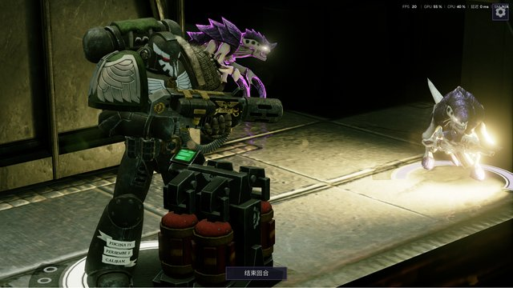
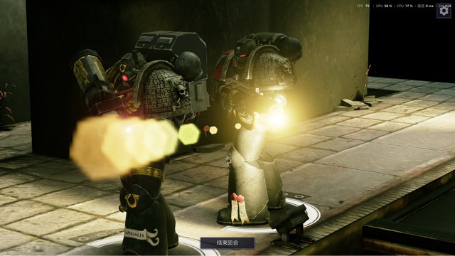
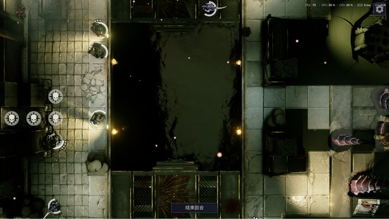
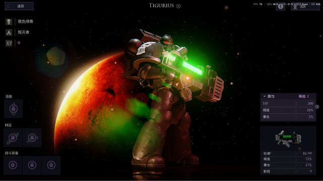

<h1 align="center">Deathwatch Patch Installer</h1>

<h3 align="center">Patch your existing Deathwatch install. Safely.</h3>
<p align="center">A community-made, data-driven installer for Deathwatch (Steam AppID 394450, build 1837603). Backup, calculate, apply and restore — without shipping game assets.</p>

<p align="center">
  <a href="#download"><b>Download</b></a> · <a href="#features">Features</a> ·
  <a href="#how-it-works">How it works</a> · <a href="#install">Install</a> ·
  <a href="#docs">Docs</a> · <a href="#support-deathwatch-patch-installer">Support</a>
</p>

<p align="center">
  <a href="https://github.com/monkeyrs/deathwatch-patch-installer/releases/latest"></a>
  <a href="LICENSE"></a>
  <a href="https://www.python.org/downloads/"></a>
  <a href="https://ko-fi.com/monkeyrs" rel="nofollow"></a>
</p>

<p align="center"><b>English</b> · <a href="docs/lang/README.zh-CN.md">简体中文</a></p>

**Free, open source, and yours to inspect.** The installer only works on a legally owned local copy of the game. It does **not** distribute the game executable, `.uasset` / `.locres` files, audio, artwork, or full configuration files. Every change is recipe-based, calculated against your original files, and backed up before being written.

<table align="center">
  <tr>
    <td align="center"><a href="docs/media/full/shot-01-combat-closeup.png"></a><br><sub>Combat UI</sub></td>
    <td align="center"><a href="docs/media/full/shot-02-combat-fire.png"></a><br><sub>Combat effects</sub></td>
  </tr>
  <tr>
    <td align="center"><a href="docs/media/full/shot-03-tactical-map.png"></a><br><sub>Tactical view</sub></td>
    <td align="center"><a href="docs/media/full/shot-04-character-sheet.png"></a><br><sub>Character sheet</sub></td>
  </tr>
</table>

<a id="download"></a>

## Download

**[Download DeathwatchPatchInstaller.exe (v1.4) →](https://github.com/monkeyrs/deathwatch-patch-installer/releases/latest)**

The release is a single Windows executable. End users do not need Python or an internet connection. Pick your game executable and the installer derives the game root, verifies the build, then offers the feature cards.

<a id="features"></a>

## Features

| Feature | What it does |
| --- | --- |
| **Chinese Text** | Full Chinese UI, flair and chapter names, generated at install time; selected by default when the system language is Chinese. |
| **Bug Fixes** | Eight player-verified fixes, enabled by default. See [bug details](src/bugfix_list_en.md). |
| **Visual Enhancement** | Three config-level tiers — Integrated / Discrete / Max. Original look is restored with the Restore action. See [visual details](src/visual_list_en.md). |
| **Camera Unlock** | Removes camera height / pitch limits. Off by default with an on-screen caution. |
| **Weapon Balance (r30)** | Fan-made weapon numerical tweaks (42 OK slots, max deviation 0.00%) plus original-game granted skills for three T2 chapter weapons. Off by default, backed up and reversible. See [balance details](src/balance_list_en.md). |
| **Bonus: Black Shield** | Adds a Black Shield to your save. Backs up the save first; restoring loses progress made after injection. |

Chinese voice acting is **not** distributed or downloaded. The installer only shows a local DIY prompt.

<a id="how-it-works"></a>

## How it works

1. You select the game executable; the installer derives the game root and checks `buildid = 1837603`.
2. Each selected feature is resolved from `src/features.json` into recipes — no game assets are embedded.
3. Before writing, the original file is copied to `<game root>/.dwpatch_backup/<UTC>/files/`, with a global `index.json` keeping the earliest original.
4. SHA-256 state detection distinguishes vanilla / patched / partial / unknown, and pre-restores selected items before reapplying.
5. **Restore to vanilla** uses the global backup index.

All logs and backups stay inside the game directory. The installer never reads a parent `patches/` folder or game assets from the developer's workspace.

<a id="install"></a>

## Install from source

<details open>
<summary><b>Set up the environment</b></summary>

```powershell
git clone https://github.com/monkeyrs/deathwatch-patch-installer.git
cd deathwatch-patch-installer
python -m venv .venv
.\.venv\Scripts\python.exe -m pip install -r requirements-dev.txt
```

Requires Python 3.13, PySide6 6.12.0, PyInstaller 6.22.3 and openpyxl (maintainer tooling only).

</details>

```powershell
.\.venv\Scripts\python.exe src\main.py
```

<details>
<summary><b>Tests and build</b></summary>

Run the offscreen smoke test (no window, no real game directory is written):

```powershell
.\.venv\Scripts\python.exe tests\smoke_test.py
```

Build the single-file executable:

```powershell
powershell -ExecutionPolicy Bypass -File .\build.ps1
```

The output is `dist\DeathwatchPatchInstaller.exe`. The spec prunes unused Qt modules; if you need one back, edit `_EXCLUDE_PREFIXES` in `DeathwatchPatchInstaller.spec` instead of adding game resources to the payload.

</details>

<a id="docs"></a>

## Docs

- [Design and delivery plan](docs/PLAN.md)
- [Third-party notices](THIRD_PARTY_NOTICES.md)
- [Feature registry](src/features.json)
- [Bug details](src/bugfix_list_en.md) · [Visual details](src/visual_list_en.md) · [Balance details](src/balance_list_en.md) · [Balance at a glance](docs/balance-at-a-glance.md)

## Project layout

- `src/` — runtime code and built-in data (`main.py`, `ui_kit.py`, `patcher.py`, `i18n.py`, `features.json`, `zh_runtime.json`, `payload/`, `zhgen/`, `saveinject/`).
- `tools/` — maintainer tools for Chinese export, payload rebuild and self-test.
- `tests/smoke_test.py` — offscreen smoke test.
- `docs/` — planning and notes.
- `licenses/` — PySide6 / Qt, PyInstaller and other license texts.

<a id="support-deathwatch-patch-installer"></a>

## Support Deathwatch Patch Installer

If this installer saved you time, you can support development with a coffee.

[Support me on Ko-fi](https://ko-fi.com/monkeyrs)

[GPL-3.0 license](LICENSE) · [Third-party notices](THIRD_PARTY_NOTICES.md) · [Report an issue](https://github.com/monkeyrs/deathwatch-patch-installer/issues)
