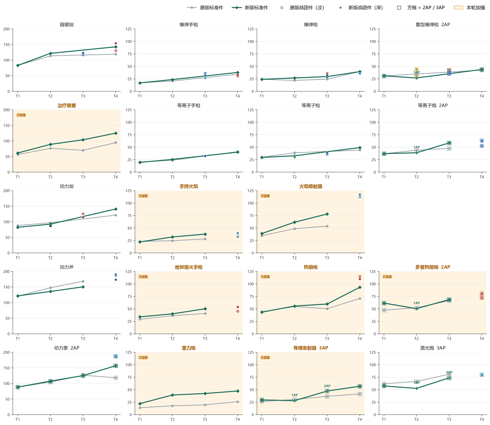
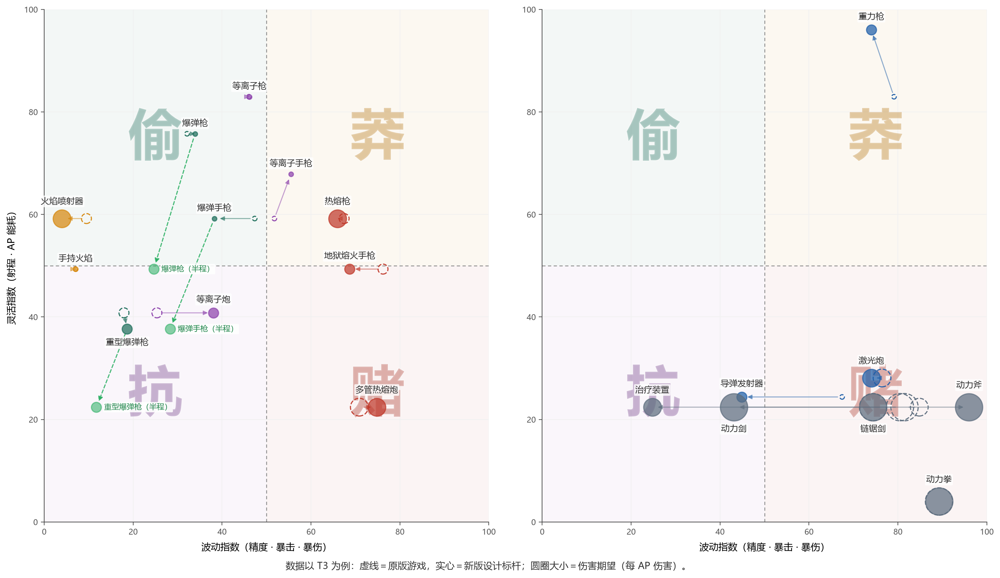

# Balance at a glance · 平衡性一览

**EN** — r27 tunes weapons only: 89 OK slots, max final-value deviation 0.40%, and three T2 chapter weapons also gain original-game granted skills. Values follow `final = base + step × delta`; marines are untouched. Same-tier AP variants target 1AP:2AP:3AP DPA ≈ 25:30:33; 27 chapter items stay within ±20% of same-tier standards.

**中文** — r27 仅调整武器：89 个 OK 槽位，最大终值偏差 0.40%，另为三件 T2 战团武器加入原版授予技能。数值按 `final = base + step × delta` 计算，不改战士。同档 1AP:2AP:3AP 的 DPA 目标约为 25:30:33，27 件战团件均收敛到同档标准件的 ±20% 内。

Fig. 1 — DPA ladder: grey = vanilla standard-item family mean, green = new standard-item mean; chapter items are coloured dots and are not part of the connecting lines. 图 1 — DPA 梯度：灰色＝原版标准件族均值，墨绿＝新版标准件均值；战团件以彩色点单独标出，不参与连线。

Fig. 2 — Feel quadrants (T3): dashed = vanilla, solid = new T3 benchmark, light green = bolt half-course bonus; circle size tracks DPA, X = volatility, Y = flexibility. 图 2 — 手感四象限（T3）：虚线＝原版，实心＝新版 T3 标杆，浅绿＝爆弹系半程加成；圆面积＝DPA，横轴＝波动，纵轴＝灵活。

Full notes: [English](../src/balance_list_en.md) · [简体中文](../src/balance_list_zh.md)
