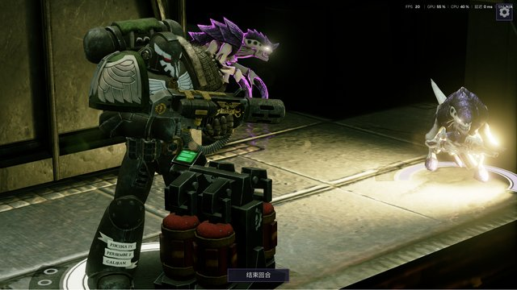
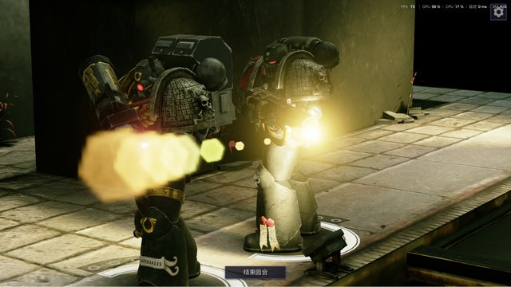
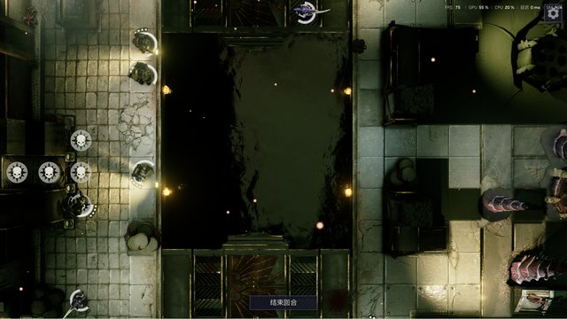
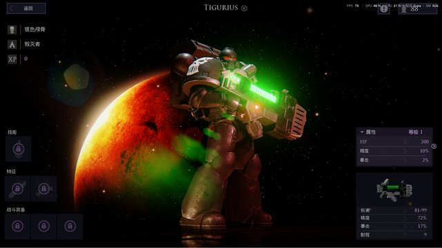

<h1 align="center">Deathwatch 补丁安装器</h1>

<h3 align="center">给自己已有的 Deathwatch 打补丁，安全地。</h3>
<p align="center">面向 Deathwatch（Steam AppID 394450，build 1837603）的社区数据驱动安装器。备份、计算、写入、还原——不分发任何游戏资源。</p>

<p align="center">
  <a href="#download"><b>下载</b></a> · <a href="#features">功能</a> ·
  <a href="#how-it-works">工作原理</a> · <a href="#install">安装</a> ·
  <a href="#docs">文档</a> · <a href="#support-deathwatch-patch-installer">支持</a>
</p>

<p align="center">
  <a href="https://github.com/monkeyrs/deathwatch-patch-installer/releases/latest"></a>
  <a href="../../LICENSE"></a>
  <a href="https://www.python.org/downloads/"></a>
  <a href="https://ko-fi.com/monkeyrs" rel="nofollow"></a>
</p>

<p align="center"><a href="../../README.md">English</a> · <b>简体中文</b></p>

**免费、开源，代码可自行审阅。** 安装器只作用于你本机已有的正版游戏，不分发游戏本体、`.uasset` / `.locres` 文件、音频、贴图或完整配置。所有改动都基于 recipe 在你的原始文件上计算，写入前逐文件备份。

<table align="center">
  <tr>
    <td align="center"><a href="../media/full/shot-01-combat-closeup.png"></a><br><sub>战斗界面</sub></td>
    <td align="center"><a href="../media/full/shot-02-combat-fire.png"></a><br><sub>战斗特效</sub></td>
  </tr>
  <tr>
    <td align="center"><a href="../media/full/shot-03-tactical-map.png"></a><br><sub>战术视图</sub></td>
    <td align="center"><a href="../media/full/shot-04-character-sheet.png"></a><br><sub>角色面板</sub></td>
  </tr>
</table>

<a id="download"></a>

## 下载

**[下载 DeathwatchPatchInstaller.exe（v1.4）→](https://github.com/monkeyrs/deathwatch-patch-installer/releases/latest)**

Release 是单文件 Windows 程序，最终用户不需要 Python，也不需要联网。选择游戏 exe 后，安装器会推导游戏根目录、校验 build，再显示功能卡片。

<a id="features"></a>

## 功能

| 功能 | 说明 |
| --- | --- |
| **中文文本** | 界面、称号、战团标签全中文；安装时就地生成。系统语言为中文时默认勾选。 |
| **Bug 修正** | 8 项已验证修复，默认勾选。详见 [Bug 详情](../../src/bugfix_list_zh.md)。 |
| **光影增强** | 三档配置级画质增强：核显 / 独显 / 最高。原版外观用「还原到原版」恢复。详见[光影详情](../../src/visual_list_zh.md)。 |
| **镜头限制解除** | 解除镜头高度 / 俯仰限制；默认不勾选，勾选时会显示谨慎提醒。 |
| **武器平衡性补丁（r30）** | 爱好者自制的武器数值调整（42 个 OK 槽，最大终值偏差 0.00%），另含三件 T2 战团武器的原版授予技能。默认不勾选，逐文件备份可还原。详见[平衡详情](../../src/balance_list_zh.md)。 |
| **武器技能补丁** | 为三件 T2 战团武器恢复原版武器赋予技能与对应军械库图标。默认不勾选。详见[技能详情](../../src/weapon_skills_list_zh.md)。 |
| **Bonus：插入一名黑盾** | 向存档加入一名黑盾。注入前会备份存档；还原存档会丢失注入之后的进度。 |

中文配音**不分发、不下载**，安装器只显示本地 DIY 提示词。

<a id="how-it-works"></a>

## 工作原理

1. 你选择游戏 exe，安装器推导游戏根目录并校验 `buildid = 1837603`。
2. 每个选中项从 `src/features.json` 解析为 recipe——不内嵌游戏资源。
3. 写入前把原文件复制到 `<游戏根>/.dwpatch_backup/<UTC>/files/`，全局 `index.json` 始终保留最早的原文件。
4. SHA-256 状态检测区分原版 / 已打 / 部分打 / 未知版本；重打前会按选中项自动预还原。
5. **还原到原版**使用全局备份索引。

所有日志和备份只写在游戏目录内。安装器不会读取开发者工作区的父目录 `patches/` 或游戏资源。

<a id="install"></a>

## 从源码运行

<details open>
<summary><b>配置环境</b></summary>

```powershell
git clone https://github.com/monkeyrs/deathwatch-patch-installer.git
cd deathwatch-patch-installer
python -m venv .venv
.\.venv\Scripts\python.exe -m pip install -r requirements-dev.txt
```

需要 Python 3.13、PySide6 6.12.0、PyInstaller 6.22.3，以及仅维护工具使用的 openpyxl。

</details>

```powershell
.\.venv\Scripts\python.exe src\main.py
```

<details>
<summary><b>测试与构建</b></summary>

运行离屏烟雾测试（不弹窗，不写真实游戏目录）：

```powershell
.\.venv\Scripts\python.exe tests\smoke_test.py
```

构建单文件 exe：

```powershell
powershell -ExecutionPolicy Bypass -File .\build.ps1
```

产物为 `dist\DeathwatchPatchInstaller.exe`。spec 已裁掉未使用的 Qt 模块；如需恢复某个模块，请修改 `DeathwatchPatchInstaller.spec` 的 `_EXCLUDE_PREFIXES`，不要往 payload 里加游戏资源。

</details>

<a id="docs"></a>

## 文档

- [设计与交付规划](../PLAN.md)
- [第三方声明](../../THIRD_PARTY_NOTICES.md)
- [特性注册表](../../src/features.json)
- [Bug 详情](../../src/bugfix_list_zh.md) · [光影详情](../../src/visual_list_zh.md) · [平衡详情](../../src/balance_list_zh.md) · [平衡性一览](../balance-at-a-glance.md) · [武器技能](../../src/weapon_skills_list_zh.md)

## 项目结构

- `src/` — 运行时代码与内置数据：`main.py`、`ui_kit.py`、`patcher.py`、`i18n.py`、`features.json`、`zh_runtime.json`、`payload/`、`zhgen/`、`saveinject/`。
- `tools/` — 维护者工具：中文导出、payload 重建、自检。
- `tests/smoke_test.py` — 离屏烟雾测试。
- `docs/` — 规划与说明。
- `licenses/` — PySide6 / Qt、PyInstaller 等许可证文本。

<a id="support-deathwatch-patch-installer"></a>

## 支持 Deathwatch 补丁安装器

如果它帮你省了时间，可以用一杯咖啡支持开发。

[Support me on Ko-fi](https://ko-fi.com/monkeyrs)

[GPL-3.0 许可证](../../LICENSE) · [第三方声明](../../THIRD_PARTY_NOTICES.md) · [反馈问题](https://github.com/monkeyrs/deathwatch-patch-installer/issues)
