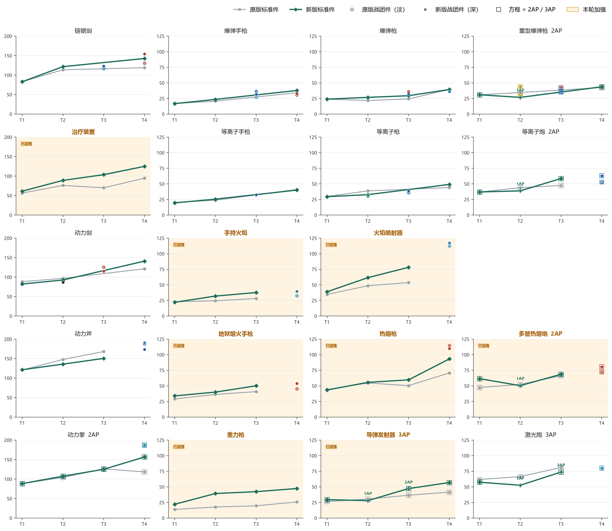

Per-family calibration: **final = base (family baseline) + step (per-tier increment) × delta (weapon's tier offset)**. Weapons only; marines and skills are untouched.

Current package: **balance_user_r22** (2026-11-22). 84 slots, max final-value deviation 4.69% within the ±5% target, 19/19 families monotonic.

Fig. 1 — DPA ladder: grey = vanilla, green = r22; hollow and solid dots show individual items and family means.

Fig. 3 — Feel quadrants: X = volatility, Y = flexibility; filled circles = r22 T3 templates, hollow circles = vanilla representatives.

- Every heavy weapon gains a usable **1AP variant**.
- Lascannon / plasma cannon: higher accuracy and close-range burst.
- Missile launcher: higher crit and splash (backend 0.35 -> 0.99; display 35% -> 99% applied after the Chinese pack).
- Melta family: stronger close-range burst (crit + accuracy).
- Grav-gun / power sword / narthesium: lower damage, higher accuracy and crit damage.
- Crippling Shot: actual trigger chance 2% -> 8% (the 1% -> 2% text fix belongs to the Bug Fixes card).
