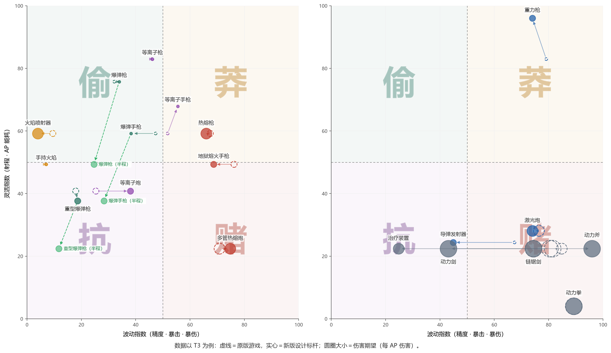

Per-family calibration: **final = base (family baseline) + step (per-tier increment) × delta (weapon's tier offset)**. Weapons only; marines are untouched.

Also includes original-game granted skills for three T2 chapter weapons: Dark Angels plasma gun (mastercrafted) gains Crippling Shot, Black Templars mastercrafted power sword gains Riposte + Parry, Imperial Fists mastercrafted heavy bolter gains Resilient + Killing Blow.

Current package: **balance_user_r27** (2026-11-23). Ammo tuning: plasma more volatile (pistol 2 / gun 3 / cannon 4 shots), bolt weapons steadier (pistol 4 / gun 5 / heavy 9 shots); plasma cannon tier curve restored -- T2 1AP variant DPA ~= 30, T3 ~= 48, T4 chapter ~= 54, still slightly above the plasma gun but below meltas. 89 OK slots, 1 known conflict (T2 missile range), max final deviation 0.4%; chapter items within +/-20% of same-tier standards, and same-tier 1AP:2AP:3AP DPA ~= 25:30:33.

Fig. 1 — DPA ladder: grey = vanilla standard-item family mean, green = new standard-item mean; chapter items are coloured dots and are not part of the connecting lines.

Fig. 2 — Feel quadrants (T3): dashed = vanilla, solid = new T3 benchmark, light green = bolt half-course bonus; circle size tracks DPA, X = volatility, Y = flexibility.

- Every heavy weapon gains a usable **1AP variant**.
- Lascannon / plasma cannon: higher accuracy and close-range burst.
- Missile launcher: higher crit and splash (backend 0.35 -> 0.99; display 35% -> 99% applied after the Chinese pack).
- Melta family: stronger close-range burst (crit + accuracy).
- Grav-gun / power sword / narthesium: lower damage, higher accuracy and crit damage.
- Crippling Shot: actual trigger chance 2% -> 8% (the 1% -> 2% text fix belongs to the Bug Fixes card).
- Imperial Fists mastercrafted heavy bolter: damage/range kept vanilla, compensated with +15 crit points.
- T4 lascannon / plasma cannon: damage brought back to sane levels, calibrated to accuracy norms (80/30).
