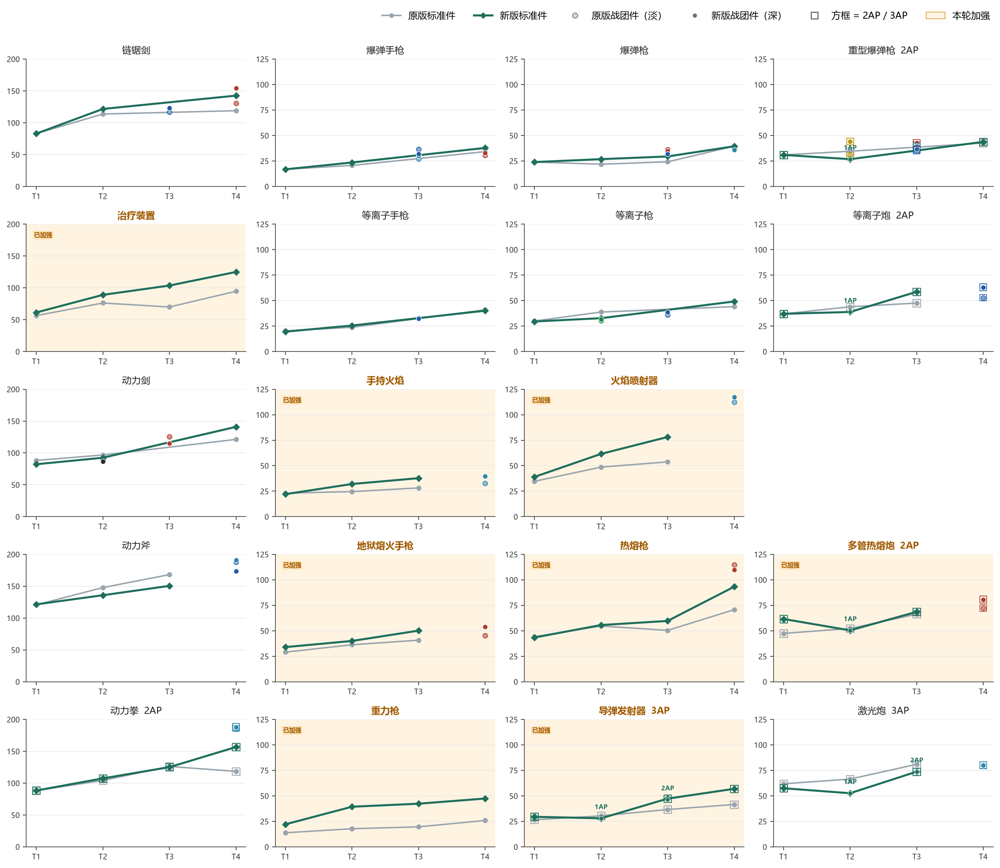
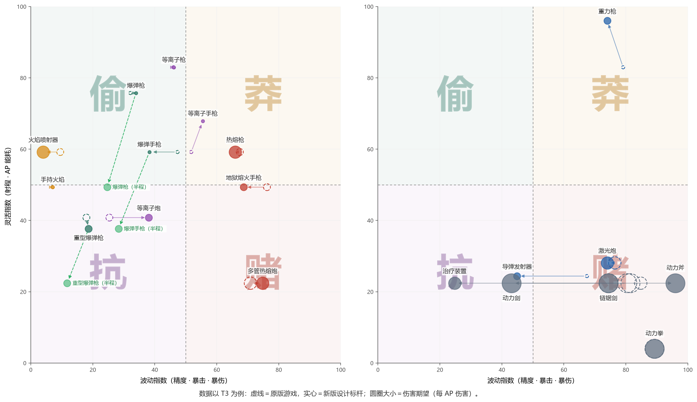

按族统一标定：**终值 = base（族基准）+ step（每阶递增）× delta（武器阶差）**。仅调武器，不改战士。

另含三件战团 T2 武器的原版授予技能：暗黑天使等离子枪(大师级)致残射击、黑色圣堂精工动力剑还击+招架、帝国之拳精工重爆坚韧+必杀一击。

当前包：**balance_user_r27**（2026-11-23）。弹发调整：等离子系更赌（手枪2/枪3/炮4发）、爆弹系更稳（手枪4/枪5/重爆9发）；等离子炮梯度回调到健康坡度——T2 1AP 变体 DPA≈30、T3≈48、T4 战团≈54，等离子炮仍稍强于等离子枪但低于热熔。89 个 OK 槽、1 已知冲突（T2 导弹射程）、最大终值偏差 0.4%；战团件按同档标准件 ±20% 收敛、同档 1AP:2AP:3AP DPA≈25:30:33。

图 1 — DPA 梯度：灰色＝原版标准件族均值，墨绿＝新版标准件均值；战团件以彩色点单独标出，不参与连线。

图 2 — 手感四象限（T3）：虚线＝原版，实心＝新版 T3 标杆，浅绿＝爆弹系半程加成；圆面积＝DPA，横轴＝波动，纵轴＝灵活。

- 所有重型武器获得 **1AP 可用变体**。
- 激光炮、等离子炮：提高精度与近距离爆发。
- 导弹发射器：提高暴击与溅射（后台 0.35→0.99；显示 35%→99% 在汉化之后生效）。
- 热熔系：强化近距离爆发（暴击 + 精度）。
- 重力枪、动力剑、治疗装置：降低伤害，提高精度与暴击伤害。
- 致残射击：实际触发概率 2%→8%（1%→2% 的描述修正属 Bug 修正卡）。
- 帝国之拳精工重爆：伤害/射程维持原版，改以暴击 +15 点补偿。
- T4 激光炮/等离子炮：压回合理伤害，按精度规律（80/30）定标。
